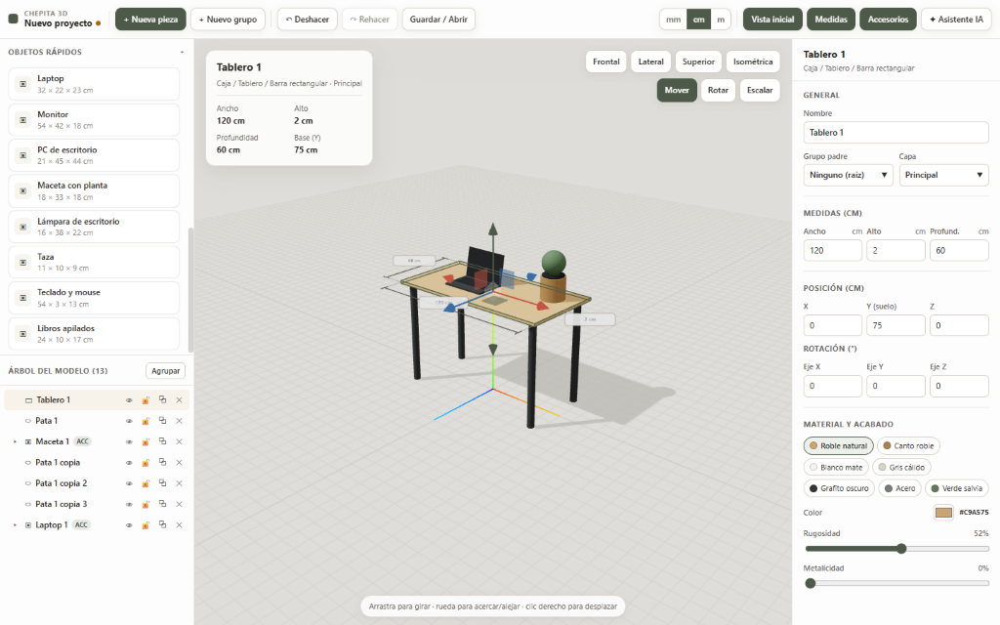
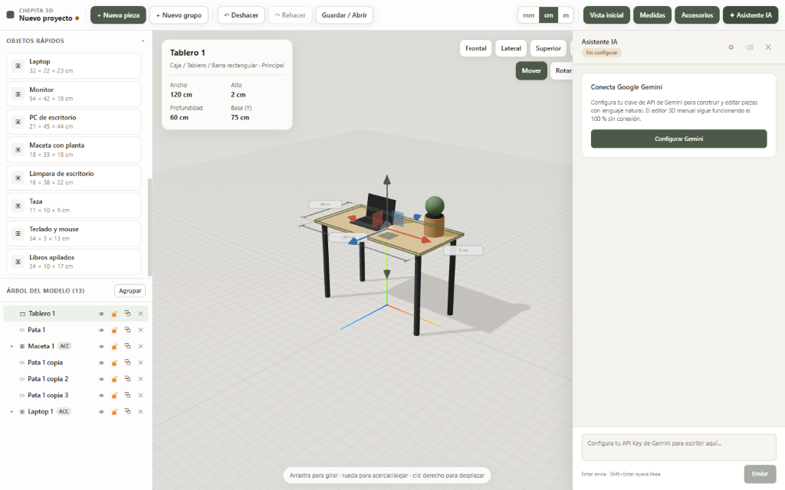
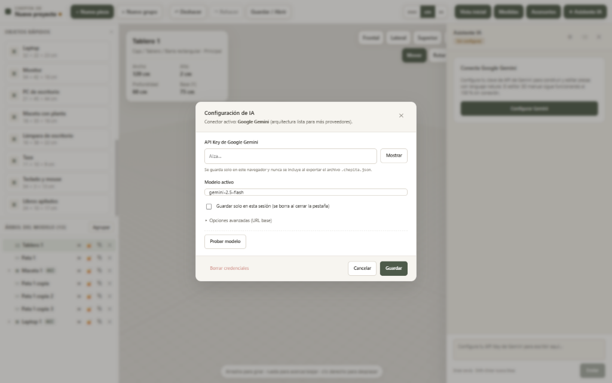

# APP-RENDER-CHEPITA

Modelador 3D paramétrico web, **local-first** y a escala real, diseñado para que personas sin experiencia previa en CAD puedan diseñar, ajustar y visualizar muebles u objetos tridimensionales mediante formularios sencillos, objetos rápidos, manipulación directa en 3D y un **Asistente de IA conversacional** (Google Gemini).

---

## Capturas de la aplicación

### Editor 3D paramétrico, cotas y panel de propiedades


### Panel lateral del Asistente IA


### Configuración privada del proveedor de IA (Google Gemini)


---

## Características principales

- **Escena 3D interactiva:** navegación orbital, zoom, desplazamiento, vistas predefinidas (*Inicial*, *Frontal*, *Lateral*, *Superior*, *Isométrica*), suelo con sombras suaves y cuadrícula de referencia.
- **Unidades y escala real:** soporte para `mm`, `cm` y `m` con unidad interna única en **metros** (`1 unidad = 1 m`) y pivote en la base inferior (`Y = 0`) para apoyo automático sobre el suelo.
- **Creación guiada y Objetos rápidos:**
  - Primitivas editables mediante formularios en lenguaje cotidiano: **Caja / Tablero**, **Cilindro / Tubo**, **Esfera** y **Superficie / Plano**.
  - Catálogo de **Objetos rápidos** insertables con un clic o arrastrando directamente al lienzo 3D (*drag-and-drop*), con aterrizaje automático sobre el suelo o caras horizontales superiores.
- **Árbol jerárquico y capas:** agrupar/desagrupar, renombrar, ocultar/mostrar, bloquear/desbloquear, **duplicar** (piezas y grupos al lado del original con sufijo `"copia"`), **eliminar** y capa de **Accesorios** (`main` / `accessories`) con visibilidad rápida.
- **Manipulación directa y cotas:** gizmos de *Mover*, *Rotar* y *Escalar* (el escalado actualiza las dimensiones geométricas reales sin dejar escala arbitraria), cotas exteriores dinámicas y ficha resumen de medidas en pantalla.
- **Materiales y acabados:** presets (roble, blanco mate, acero, grafito, verde salvia, etc.) y personalización de color, rugosidad y metalicidad con propagación en lote a grupos.
- **Asistente IA conversacional (Google Gemini):**
  - Configura tu propia `API Key` de **Google Gemini** con prueba de conexión (*"Probar modelo"*) y opción **"Guardar solo en esta sesión"** (`sessionStorage`). Las credenciales nunca se exportan en el `.chepita.json`.
  - Traduce indicaciones en español a un **plan validado** con lista de pasos y confirmación explícita (**"Aplicar"**) antes de tocar la escena 3D.
  - Ejecución atómica reversible con un solo clic en **Deshacer** e historial de chat persistido en el proyecto (`.chepita.json`, retrocompatible con `schemaVersion: 1`).
  - Totalmente opcional: el editor manual funciona al 100 % sin conexión ni configuración de IA.
- **Persistencia local e historial:** guardado local en **IndexedDB**, exportación/importación en formato **JSON nativo versionado (`schemaVersion: 1`)** y *Deshacer / Rehacer* (`Undo / Redo`) con transacciones.

---

## Instalación

### Requisitos previos
- **Node.js** 18 o superior
- **npm** 9 o superior

### Pasos de instalación

1. Clona el repositorio e ingresa a la carpeta del proyecto:
   ```bash
   git clone https://github.com/FelipeMendozaG/app-chepe-render.git
   cd app-chepe-render
   ```
2. Instala las dependencias:
   ```bash
   npm install
   ```
3. Inicia el servidor de desarrollo:
   ```bash
   npm run dev
   ```
4. Abre en tu navegador la URL local que muestre Vite (por defecto `http://localhost:5173`).

### Build de producción

```bash
npm run build
npm run preview
```

---

## Guía de uso rápido

1. **Crear piezas y muebles:**
   - Usa **`+ Nueva pieza`** en la barra superior para crear una primitiva con medidas exactas, o haz clic / arrastra desde **Objetos rápidos** en el panel izquierdo.
   - Cambia la unidad visible en cualquier momento entre **`mm`**, **`cm`** y **`m`**.
2. **Editar medidas, posición y materiales:**
   - Selecciona cualquier pieza en el lienzo 3D o en el **Árbol del modelo** para editar sus dimensiones, posición (`Y` respecto al suelo), rotación y acabado en el panel derecho.
   - Usa los botones **Mover**, **Rotar** y **Escalar** sobre el viewport para manipulación directa con gizmos.
3. **Organizar el proyecto:**
   - Crea grupos con **`+ Nuevo grupo`** o agrupa piezas desde el árbol.
   - Marca elementos decorativos en la capa **Accesorios** y alterna su visibilidad con el botón **Accesorios** de la barra superior.
4. **Usar el Asistente IA (opcional):**
   - Haz clic en **`✦ Asistente IA`** en la barra superior para abrir el drawer lateral derecho.
   - Abre el botón de engranaje (`⚙`), pega tu `API Key` de **Google Gemini**, elige el modelo (por ejemplo `gemini-2.5-flash`), pulsa **`Probar modelo`** y guarda.
   - Escribe lo que deseas construir o modificar (por ejemplo: *"Crea una mesa de 140 × 70 × 75 cm con cubierta de roble y 4 patas metálicas agrupadas como Base"*).
   - Revisa el **Plan propuesto** y pulsa **`Aplicar plan`** para construirlo en una sola operación reversible con **`Deshacer`**.
5. **Guardar y respaldar:**
   - Haz clic en **`Guardar / Abrir`** para guardar en **IndexedDB** o exportar/importar tu proyecto en formato `.chepita.json`.

---

## Stack tecnológico y arquitectura

- **Frontend:** React 19 + TypeScript (estricto) + Vite
- **Estado:** Zustand (historial *Undo / Redo* y transacciones)
- **Motor 3D:** Three.js encapsulado e imperativo (suscripción incremental y `dispose()` limpio)
- **IA:** Módulo desacoplado (`AIProviderAdapter`, adaptador REST nativo para Google Gemini, validador y ejecutor atómico)
- **Estilos:** CSS puro / CSS Modules (sin Tailwind CSS)
- **Pruebas:** Vitest

```text
src/
├── domain/       # Modelo de dominio puro (tipos, unidades, geometría/AABB, presets, validaciones, serializador JSON)
├── store/        # Estado reactivo con Zustand e historial Undo/Redo transaccional
├── engine/       # Adaptador Three.js encapsulado (cámara, mallas, gizmos, cotas, drag-and-drop)
├── persistence/  # Repositorio local en IndexedDB, respaldo JSON portátil y configuración privada de IA
├── ai/           # Adaptador Gemini, contexto de escena, prompts, validador estricto y ejecutor atómico
└── ui/           # Componentes React y CSS Modules (TopBar, LeftPanel, Viewport, RightPanel, Modals, AI Drawer)
```

---

## Comandos disponibles

| Comando | Descripción |
| :--- | :--- |
| `npm run dev` | Inicia el servidor de desarrollo Vite |
| `npm run typecheck` | Ejecuta verificación estricta de TypeScript (`tsc --noEmit`) |
| `npm test` | Ejecuta la suite de pruebas unitarias con Vitest |
| `npm run test:watch` | Ejecuta Vitest en modo observación |
| `npm run build` | Verifica tipos y genera el bundle de producción en `dist/` |
| `npm run preview` | Previsualiza localmente el build de producción |
| `npm run reindex` | Reindexa el repositorio en `codebase-memory` (`persistence: true`) |
| `npm run hooks:install` | Configura `git core.hooksPath` en `.githooks` |

---

## Documentación de referencia

- [`proyecto.md`](./proyecto.md) — Especificación funcional, UX y formato JSON nativo (v0.7).
- [`ia-agents-requerimiento.md`](./ia-agents-requerimiento.md) — Especificación del Módulo de Agente de IA (v1.1).
- [`AGENTS.md`](./AGENTS.md) — Guía arquitectónica y reglas operativas del repositorio.
- [`escritorio_en_L_render_3d.html`](./escritorio_en_L_render_3d.html) — Prototipo visual de referencia.
